# Low Poly Brazil Props Kit: free CC0 low poly 3D props from Brazilian scenery

🇬🇧 English · **🇧🇷 [Leia em português](README.pt-BR.md)**

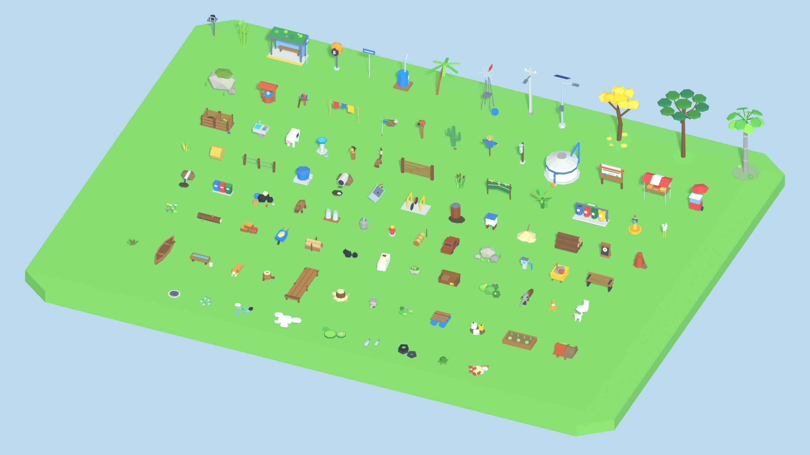

▶️ **[Watch the video on YouTube](https://www.youtube.com/watch?v=QNr0wf4MUew)** · **[Download on itch.io](https://kkyqr.itch.io/low-poly-brazil-props-kit)** (free, optional donation)

> **Short answer:** the Low Poly Brazil Props Kit (*Kit Props Brasil Low Poly*) is a **free, public domain
> (CC0 1.0)** pack of **low poly 3D props in glTF/GLB** that bring Brazilian scenery to games: wildflowers, termite
> mounds, mandacaru cactus, water lilies, capybaras, egrets, the caramel street dog, the shell-shaped *orelhão*
> phone booth, street market stalls, hay bales, wooden piers, rain barrels, solar street lights and **pollution
> signs** (trash piles, floating plastic, river foam, sewage pipes). Almost every prop has **150 triangles or
> fewer**, flat colors and no textures, so you can scatter hundreds of them. Works in Godot, Unity, Unreal,
> three.js, Babylon.js and Blender. Commercial use is allowed and attribution is optional.

Light **low poly props** for **environmental storytelling**: scatter nature on a new map, let daily life appear
as a city grows, show sustainable technology next to the buildings that bring it, and make pollution *visible*
(and disappear when the player cleans it up). Everything is **binary glTF (`.glb`)** with flat colors and no
textures. Made for **educational games, city builders, simulation and tycoon games, game jams and prototypes**.

**Public domain ([CC0 1.0](LICENSE)).** Use it however you like, in personal, educational or commercial
projects; modify and redistribute it. Attribution is optional (see [CITATION.cff](CITATION.cff)). No warranty.

**Contents:** [How to use](#how-to-use) · [Catalog](#catalog) · [Build or modify](#build-or-modify-the-models) ·
[FAQ](#faq) · [Origin and credits](#origin-and-credits)

> File and folder names are in Portuguese (for example `rua/orelhao.glb` = shell-shaped phone booth). The catalog
> below lists every file with its English name.

## How to use

- Download the repository (**Code → Download ZIP**) or just the `.glb` files you need from [`models/`](models).
- **Scale:** "toy" scale that matches a city grid where **1 lot = 2 × 2 units** (a fire hydrant is about 0.3
  units tall, a park bench 0.72 wide), the same as the
  [Low Poly City Kit](https://github.com/kayquer/kit-cidade-lowpoly).
- **Orientation:** Y up, model front facing **-Z** (glTF convention). Land props stand on y = 0; water props
  (water lilies, floating trash, foam, buoy, canoe, dead fish) sit **on the water surface at y = 0**.
- **Front matters** for a few props: `rio/trapiche` (the pier juts 1.4 units forward, toward -Z, from its base on
  the bank), `poluicao/manilha_esgoto` (the pipe pours toward -Z) and the signs, phone booth and water meter
  (face -Z). Turn their front toward the water or the street.
- **Materials:** one material per color (PBR, base color only, roughness 0.85). To batch everything into a
  single draw call, convert material colors into vertex colors and merge or instance the props in your engine.
- **Budget:** the categories nature, wildlife, street, countryside, river, sustainable technology and pollution
  signs have **at most 150 triangles** per prop (most between 50 and 140); `detalhados/` (detailed) and
  `arvores/` (trees) go up to 1,500. Every file is under 150 KB.

## Catalog

<!-- catalogo:inicio -->
**100 models** in 9 categories.

### Nature · Natureza (16)

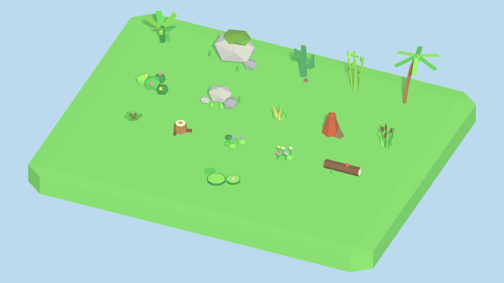

| | Model | Description | Tris |
|---|---|---|---:|
| 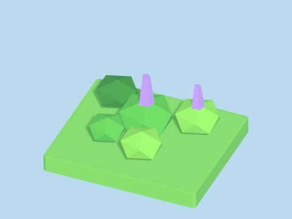 | [`aguape`](models/natureza/aguape.glb) | Floating water hyacinths with lilac flowers (grow in sewage-rich water) | 132 |
| 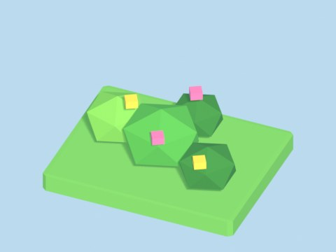 | [`arbustos`](models/natureza/arbustos.glb) | Flowering shrubs | 128 |
| 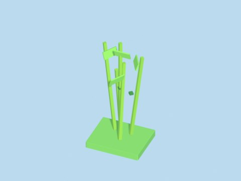 | [`bambu`](models/natureza/bambu.glb) | Bamboo clump: five green culms with darker nodes and leaf tufts | 132 |
| 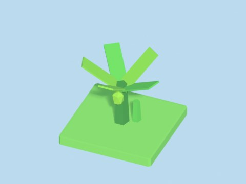 | [`bananeira`](models/natureza/bananeira.glb) | Banana plant clump with wide fanned leaves and a green bunch | 112 |
| 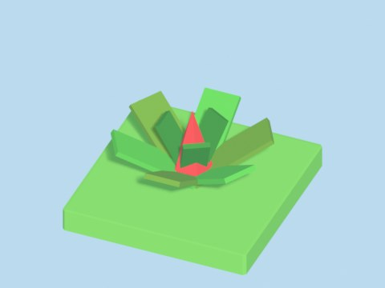 | [`bromelia`](models/natureza/bromelia.glb) | Bromeliad rosette with a red center | 116 |
| 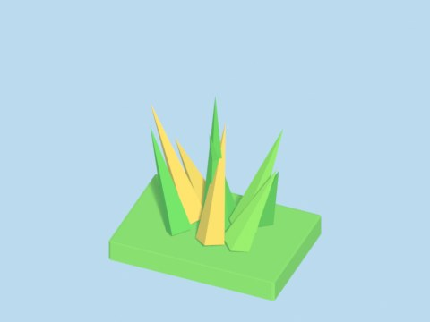 | [`capim_alto`](models/natureza/capim_alto.glb) | Tall grass tuft | 54 |
| 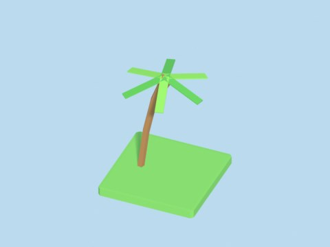 | [`coqueiro`](models/natureza/coqueiro.glb) | Coconut palm with a thin curved trunk, drooping fronds and coconuts | 140 |
| 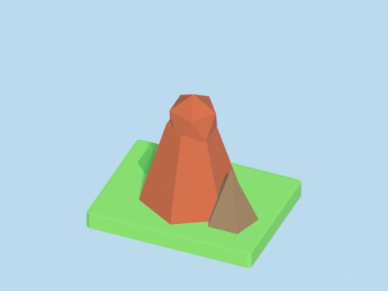 | [`cupinzeiro`](models/natureza/cupinzeiro.glb) | Red-earth termite mound | 54 |
| 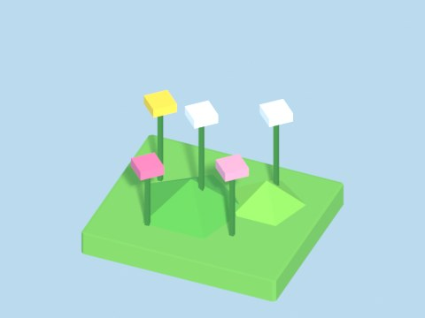 | [`flores_campo`](models/natureza/flores_campo.glb) | Wildflowers | 136 |
| 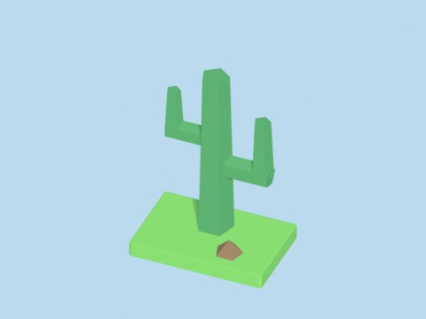 | [`mandacaru`](models/natureza/mandacaru.glb) | Mandacaru cactus with two arms | 88 |
| 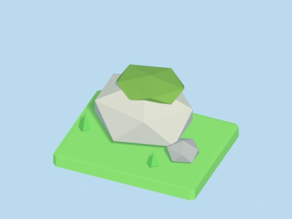 | [`matacao`](models/natureza/matacao.glb) | Large mossy boulder | 78 |
| 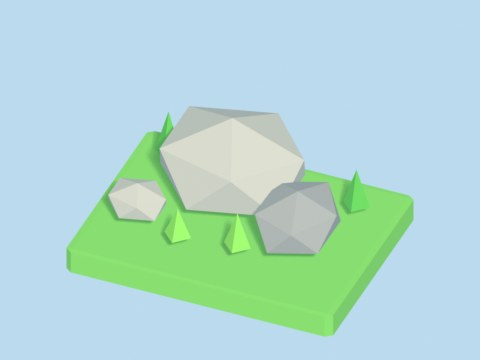 | [`pedras`](models/natureza/pedras.glb) | Riverside rocks with grass tufts | 84 |
| 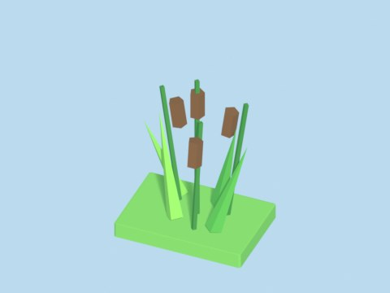 | [`taboa`](models/natureza/taboa.glb) | Cattails for the water's edge | 136 |
| 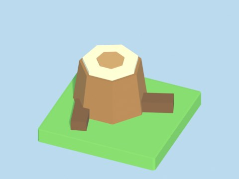 | [`toco`](models/natureza/toco.glb) | Cut tree stump | 96 |
| 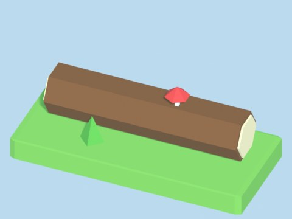 | [`tronco_caido`](models/natureza/tronco_caido.glb) | Fallen log with a mushroom | 88 |
| 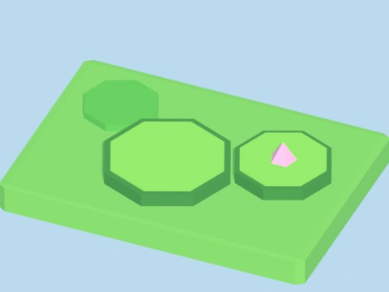 | [`vitoria_regia`](models/natureza/vitoria_regia.glb) | Giant water lilies (vitória-régia) with a pink flower, floating | 148 |

### Wildlife and animals · Fauna (13)

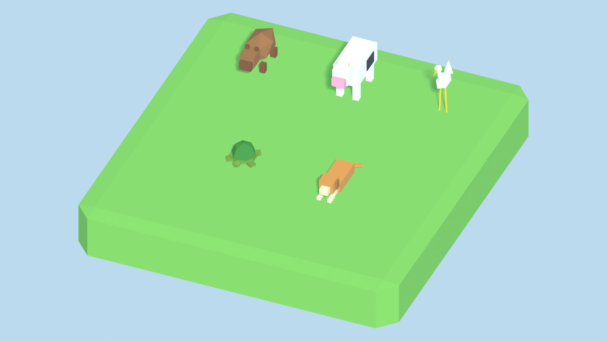

| | Model | Description | Tris |
|---|---|---|---:|
| 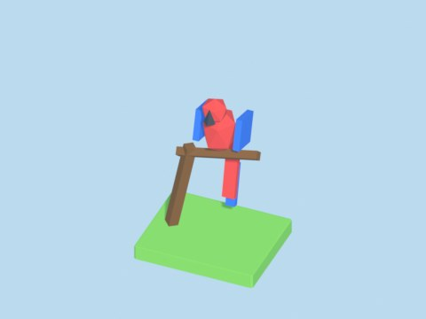 | [`arara`](models/fauna/arara.glb) | Scarlet macaw with blue wings perched on a dry branch | 118 |
| 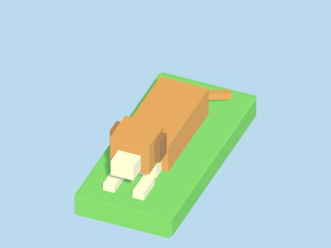 | [`cachorro_caramelo`](models/fauna/cachorro_caramelo.glb) | Caramel mutt dog lying down (Brazil's beloved street dog) | 108 |
| 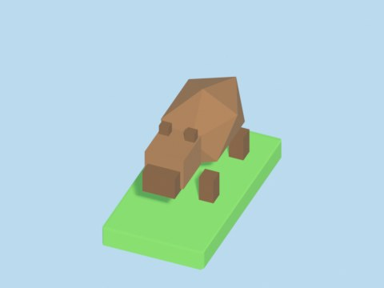 | [`capivara`](models/fauna/capivara.glb) | Capybara | 116 |
| 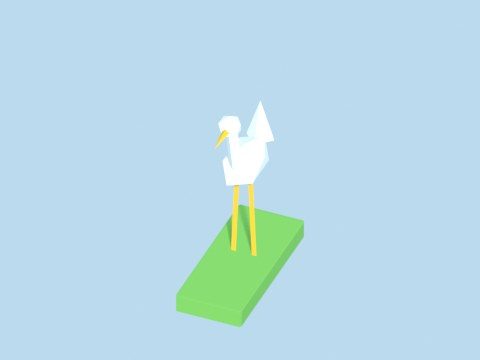 | [`garca`](models/fauna/garca.glb) | White egret standing by the water | 80 |
| 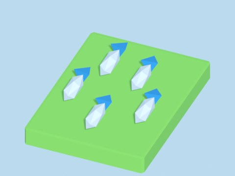 | [`lambaris`](models/fauna/lambaris.glb) | School of five small silver fish just under the water surface | 120 |
| 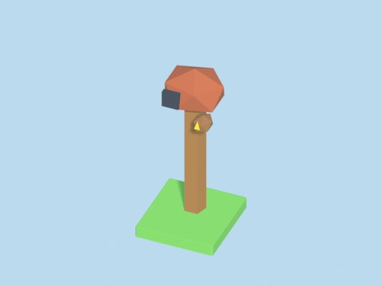 | [`ninho_joao_de_barro`](models/fauna/ninho_joao_de_barro.glb) | Rufous hornero mud nest on a fence post, with the bird | 72 |
| 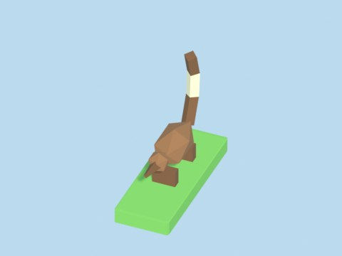 | [`quati`](models/fauna/quati.glb) | Coati with a long snout and a raised striped tail | 112 |
| 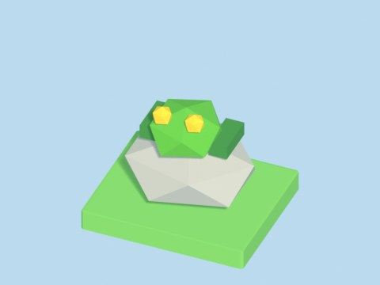 | [`sapo`](models/fauna/sapo.glb) | Green frog sitting on a riverbank pebble | 104 |
| 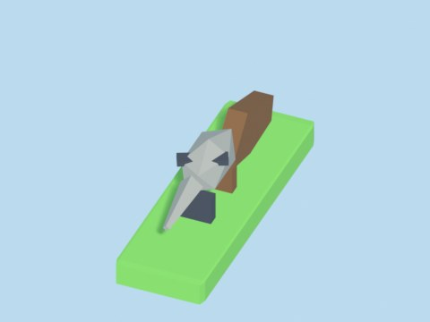 | [`tamandua`](models/fauna/tamandua.glb) | Giant anteater with a long snout and a big bushy tail | 84 |
| 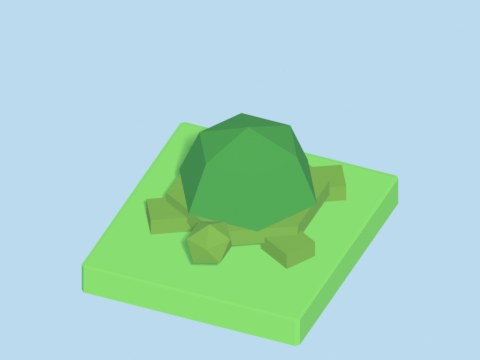 | [`tartaruga`](models/fauna/tartaruga.glb) | River turtle | 110 |
| 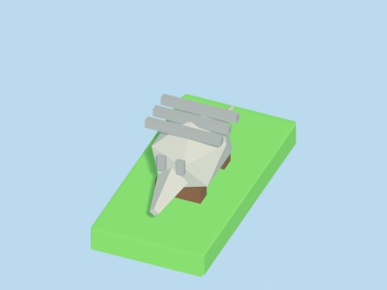 | [`tatu`](models/fauna/tatu.glb) | Armadillo with a banded gray shell | 128 |
| 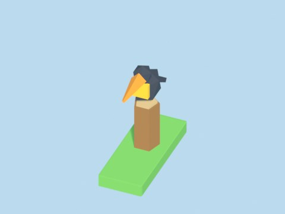 | [`tucano`](models/fauna/tucano.glb) | Toucan with a huge orange beak perched on a short stump | 108 |
| 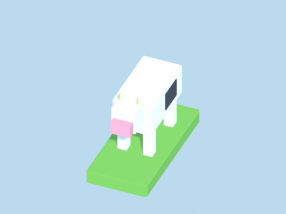 | [`vaca`](models/fauna/vaca.glb) | Spotted pasture cow | 128 |

### Street and neighborhood · Rua e bairro (20)

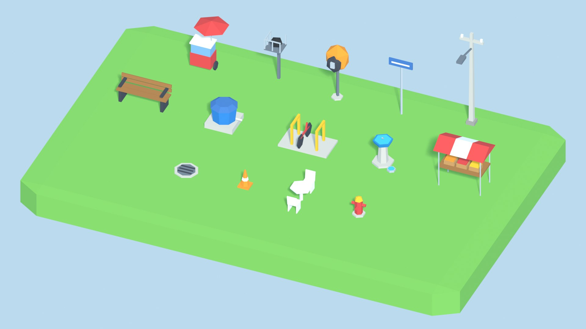

| | Model | Description | Tris |
|---|---|---|---:|
| 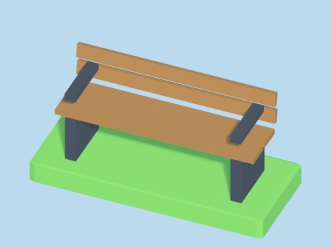 | [`banco_praca`](models/rua/banco_praca.glb) | Park bench | 96 |
| 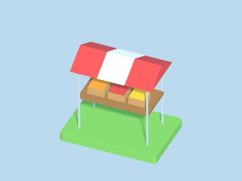 | [`barraca_feira`](models/rua/barraca_feira.glb) | Street market stall with a striped awning and fruit crates | 140 |
| 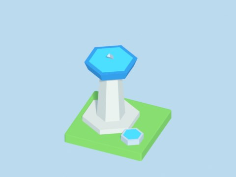 | [`bebedouro`](models/rua/bebedouro.glb) | Public drinking fountain with a pet bowl | 128 |
|  | [`bicicletario`](models/rua/bicicletario.glb) | Bike rack with a bicycle | 148 |
| 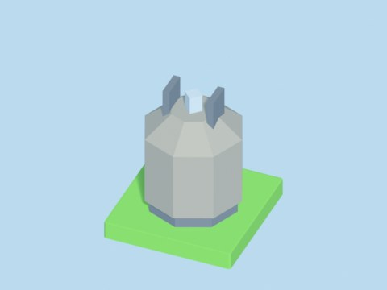 | [`botijao`](models/rua/botijao.glb) | Gray kitchen gas cylinder with handle | 120 |
| 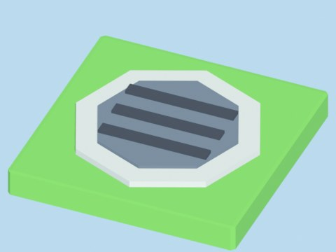 | [`bueiro`](models/rua/bueiro.glb) | Round storm drain / manhole | 92 |
|  | [`caixa_dagua`](models/rua/caixa_dagua.glb) | Blue polyethylene water tank | 80 |
| 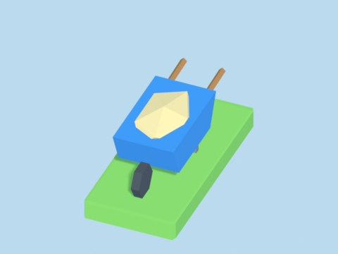 | [`carrinho_mao`](models/rua/carrinho_mao.glb) | Wheelbarrow full of sand | 100 |
| 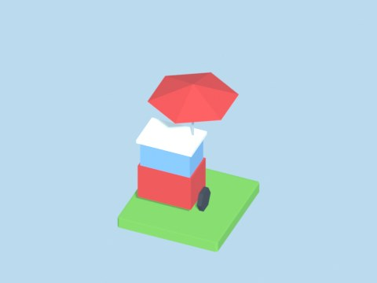 | [`carrinho_pipoca`](models/rua/carrinho_pipoca.glb) | Popcorn cart with umbrella | 112 |
| 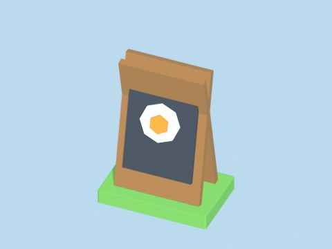 | [`cavalete_pf`](models/rua/cavalete_pf.glb) | A-frame sidewalk sign with a chalkboard showing a plate (no text) | 84 |
| 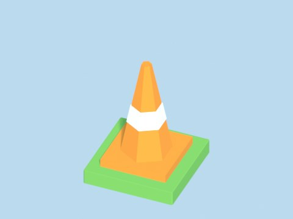 | [`cone_transito`](models/rua/cone_transito.glb) | Traffic cone | 52 |
| 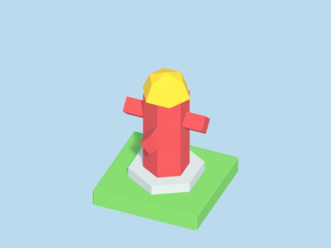 | [`hidrante`](models/rua/hidrante.glb) | Fire hydrant | 98 |
| 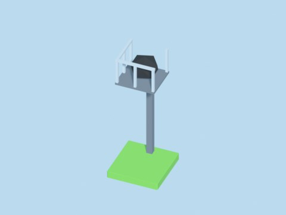 | [`lixeira_grade`](models/rua/lixeira_grade.glb) | Raised wire trash basket on a post | 140 |
| 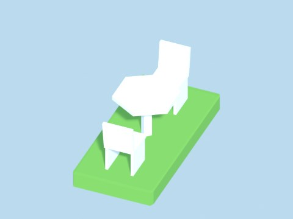 | [`mesa_cadeiras`](models/rua/mesa_cadeiras.glb) | White plastic table and two chairs (no logos) | 128 |
| 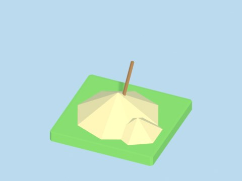 | [`monte_areia`](models/rua/monte_areia.glb) | Construction sand pile with a shovel stuck in it | 48 |
| 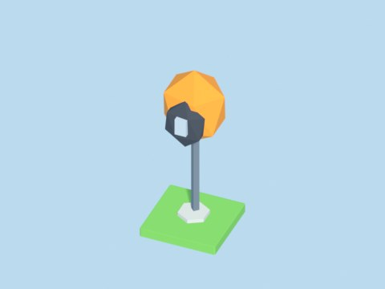 | [`orelhao`](models/rua/orelhao.glb) | Brazilian shell-shaped public phone booth (orelhão, no brand) | 84 |
|  | [`placa_rua`](models/rua/placa_rua.glb) | Blue street name sign (no letters) | 36 |
| 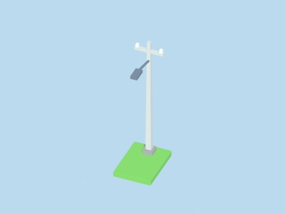 | [`poste_concreto`](models/rua/poste_concreto.glb) | Concrete utility pole with a street light | 96 |
| 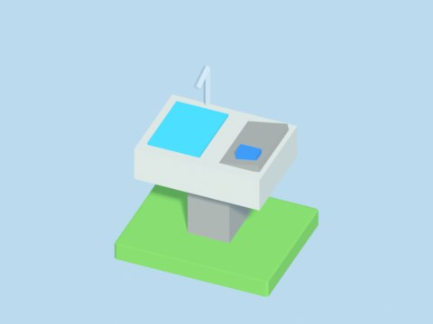 | [`tanque_lavar`](models/rua/tanque_lavar.glb) | Cement laundry sink with tap and a blue soap bar | 84 |
| 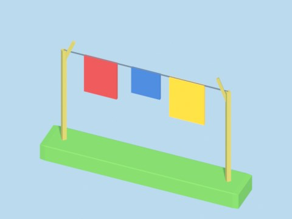 | [`varal`](models/rua/varal.glb) | Clothesline between two bamboo forks with three colorful clothes | 84 |

### Countryside · Rural (12)


| | Model | Description | Tris |
|---|---|---|---:|
|  | [`caixotes`](models/rural/caixotes.glb) | Stacked wooden crates with fruit | 108 |
|  | [`cerca_mourao`](models/rural/cerca_mourao.glb) | Wooden post and wire fence section | 60 |
|  | [`cocho_gado`](models/rural/cocho_gado.glb) | Wooden cattle water trough with a mineral salt block | 96 |
|  | [`colmeia`](models/rural/colmeia.glb) | Beehive boxes on a stand | 72 |
|  | [`espantalho`](models/rural/espantalho.glb) | Scarecrow | 120 |
|  | [`fardo_feno`](models/rural/fardo_feno.glb) | Round hay bale | 84 |
|  | [`horta`](models/rural/horta.glb) | Raised vegetable bed | 144 |
|  | [`latao_leite`](models/rural/latao_leite.glb) | Two aluminum milk cans on a wooden pallet | 108 |
|  | [`moinho_vento`](models/rural/moinho_vento.glb) | Water-pumping windmill on a thin metal tower with a small tank | 136 |
|  | [`pilha_lenha`](models/rural/pilha_lenha.glb) | Stacked eucalyptus firewood between two stakes | 120 |
|  | [`poco_caipira`](models/rural/poco_caipira.glb) | Brick countryside well with windlass, small roof and bucket | 124 |
|  | [`porteira`](models/rural/porteira.glb) | Wooden farm gate | 84 |

### River and riverside · Rio e beira d'água (6)


| | Model | Description | Tris |
|---|---|---|---:|
|  | [`bombona_flutuante`](models/rio/bombona_flutuante.glb) | Floating platform of two blue plastic drums under planks | 116 |
|  | [`canoa`](models/rio/canoa.glb) | Wooden fishing canoe, floating | 132 |
|  | [`covo`](models/rio/covo.glb) | Woven cylindrical fish trap lying on the bank, funnel facing the water | 100 |
|  | [`pescaria`](models/rio/pescaria.glb) | Bamboo fishing rod staked on the bank with line and float, dip net and bait bucket | 98 |
|  | [`rede_pesca`](models/rio/rede_pesca.glb) | Fishing net drying between two stakes | 120 |
|  | [`trapiche`](models/rio/trapiche.glb) | Small wooden pier that juts forward over the water | 120 |

### Sustainable technology · Tecnologia sustentável (7)


| | Model | Description | Tris |
|---|---|---|---:|
|  | [`barril_chuva`](models/tecnologia/barril_chuva.glb) | Rain barrel connected to a downspout | 124 |
|  | [`boia_rio`](models/tecnologia/boia_rio.glb) | River monitoring buoy with a small solar panel | 128 |
|  | [`hidrometro`](models/tecnologia/hidrometro.glb) | Water meter box | 80 |
|  | [`lixeiras_coleta`](models/tecnologia/lixeiras_coleta.glb) | Simple recycling bins (blue, red, green) | 120 |
|  | [`placa_educativa`](models/tecnologia/placa_educativa.glb) | Educational riverside sign (no letters) | 132 |
|  | [`pluviometro`](models/tecnologia/pluviometro.glb) | Rain gauge on a post | 88 |
|  | [`poste_solar`](models/tecnologia/poste_solar.glb) | Solar street light | 112 |

### Pollution signs · Sinais de poluição (19)


| | Model | Description | Tris |
|---|---|---|---:|
|  | [`barranco_erodido`](models/poluicao/barranco_erodido.glb) | Eroded red-earth riverbank collapsing with exposed roots | 140 |
|  | [`cacamba_entulho`](models/poluicao/cacamba_entulho.glb) | Small yellow dumpster overflowing with rubble | 88 |
|  | [`cano_pvc`](models/poluicao/cano_pvc.glb) | Improvised PVC pipe pouring dark sewage from the bank into the water | 92 |
|  | [`carcaca_carro`](models/poluicao/carcaca_carro.glb) | Rusty abandoned car shell without wheels on concrete blocks | 96 |
|  | [`carrinho_mercado`](models/poluicao/carrinho_mercado.glb) | Shopping cart tipped half-sunk in a stream | 68 |
|  | [`entulho`](models/poluicao/entulho.glb) | Construction rubble pile | 102 |
|  | [`espuma_rio`](models/poluicao/espuma_rio.glb) | Pollution foam floating on a river | 100 |
|  | [`galao_agrotoxico`](models/poluicao/galao_agrotoxico.glb) | Empty unlabeled pesticide jugs dumped with a dark leak stain | 104 |
|  | [`geladeira_velha`](models/poluicao/geladeira_velha.glb) | Rusty old fridge dumped on its back with the door ajar | 60 |
|  | [`lixo_flutuante`](models/poluicao/lixo_flutuante.glb) | Floating plastic bottles and bags | 128 |
|  | [`manilha_esgoto`](models/poluicao/manilha_esgoto.glb) | Concrete sewage pipe dumping dark water from a riverbank | 128 |
|  | [`monte_lixo`](models/poluicao/monte_lixo.glb) | Illegal trash dump pile | 136 |
|  | [`peixe_morto`](models/poluicao/peixe_morto.glb) | Dead fish floating belly-up (no gore) | 92 |
|  | [`pilha_toras`](models/poluicao/pilha_toras.glb) | Pile of thick felled logs waiting for the truck (deforestation) | 144 |
|  | [`pneus_velhos`](models/poluicao/pneus_velhos.glb) | Old tires holding stagnant water | 136 |
|  | [`saco_lixo`](models/poluicao/saco_lixo.glb) | Black trash bags | 78 |
|  | [`sofa_velho`](models/poluicao/sofa_velho.glb) | Abandoned old sofa with a torn cushion | 72 |
|  | [`tambor_enferrujado`](models/poluicao/tambor_enferrujado.glb) | Rusty leaking drum | 132 |
|  | [`toco_serrado`](models/poluicao/toco_serrado.glb) | Freshly sawn tree stump with sawdust and wood chips (deforestation) | 102 |

### Detailed (up to 1,500 tris) · Detalhados (até 1.500 tris) (4)


| | Model | Description | Tris |
|---|---|---|---:|
|  | [`cisterna`](models/detalhados/cisterna.glb) | Rainwater cistern (Brazilian semi-arid) with hand pump and bucket | 600 |
|  | [`composteira`](models/detalhados/composteira.glb) | Two-bay wooden compost bin with a shovel | 1332 |
|  | [`lixeira_seletiva`](models/detalhados/lixeira_seletiva.glb) | Four-bin recycling station on two posts | 936 |
|  | [`ponto_onibus`](models/detalhados/ponto_onibus.glb) | Bus stop shelter with a green roof | 480 |

### Native trees (up to 1,500 tris) · Árvores nativas (até 1.500 tris) (3)


| | Model | Description | Tris |
|---|---|---|---:|
|  | [`araucaria`](models/arvores/araucaria.glb) | Araucaria (Paraná pine) with layered flat crown and a pine cone | 548 |
|  | [`buriti`](models/arvores/buriti.glb) | Buriti palm in a marshy patch, drooping fronds and coconut bunches | 636 |
|  | [`ipe_amarelo`](models/arvores/ipe_amarelo.glb) | Yellow ipê tree with an open blooming crown and fallen flowers | 388 |

<!-- catalogo:fim -->

## Build or modify the models

Every model is a short Python script in `src/<category>/<id>.py` that uses the building blocks in
[`src/lib.py`](src/lib.py) (boxes, cylinders, cones, pipes, low icospheres…) and a single shared color palette.
Requires Blender 4.5 LTS.

```bash
blender -b --factory-startup --python src/rua/orelhao.py              # one model → models/rua/orelhao.glb
blender -b --factory-startup --python src/gerar_todos.py              # all models (+ models/catalogo.json)
blender -b --factory-startup --python src/gerar_todos.py -- poluicao  # a single category
blender -b --factory-startup --python src/vitrine.py -- tudo --cada   # preview images in previews/
blender -b --factory-startup --python src/vitrine.py -- todos         # previews/todos.jpg (rename to capa.jpg)
py -3 tools/atualizar_readme.py                                       # rebuilds the catalog in both READMEs
```

To create a new prop: copy a similar script, build it with its **front facing Blender -Y** (`exportar` rotates it
180° so the front ends up at -Z in glTF), use only colors from `PALETA`, no bevel (it costs triangles), and add
its English name to [`tools/nomes_en.json`](tools/nomes_en.json).

## FAQ

**Can I use these props in a commercial game?**
Yes. Everything is public domain (CC0 1.0): commercial use, modification and redistribution are allowed, with no
permission or payment needed.

**Do I need to give credit?**
No, attribution is optional. If you want to cite the kit, the data is in [CITATION.cff](CITATION.cff).

**How light are they?**
Almost all of them have 150 triangles or fewer and no textures, so hundreds of props cost very little. Merge them
per area or use GPU instancing (one draw call per prop type).

**Why pollution props?**
They make environmental impact visible: in an educational game, trash, foam and sewage can appear as pollution
rises and go away when the player fixes the cause. The dead fish are cartoon-like, with no gore.

**What format are the models in?**
Binary glTF (`.glb`), Y up, front facing -Z, one PBR material per color (base color only, no textures or UVs).
They open directly in Godot 4, three.js (`GLTFLoader`), Babylon.js, Blender and Unreal Engine 5 (Interchange). In
Unity, use the glTFast package.

**Why are the file names in Portuguese?**
The kit was born from a Brazilian educational game. The English name of every file is in the catalog above and in
[`tools/nomes_en.json`](tools/nomes_en.json).

## Origin and credits

The kit was born from the educational game [Guardião da Água](https://github.com/kayquer/guardiao_da_agua_js)
(*Water Guardian*), a product of Cláudia Dias Roxinol's master's research (Unesp, Presidente Prudente, Brazil),
developed with Kayque Rotondo. It complements the [Low Poly City Kit](https://github.com/kayquer/kit-cidade-lowpoly)
(buildings, roads and vehicles). The models and scripts were made with Blender, with Claude (Anthropic) as an
assistant. No third-party models are included in this repository.
