# Kit Props Brasil Low Poly: props 3D low poly gratuitos (CC0) de cenário brasileiro

**🇧🇷 Português** · 🇬🇧 [Read in English](README.md)

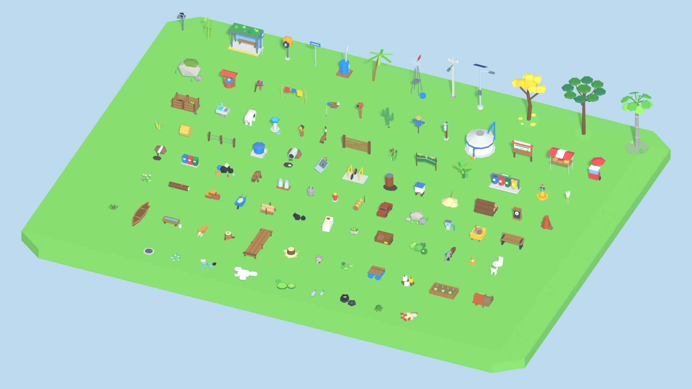

▶️ **[Assista ao vídeo no YouTube](https://www.youtube.com/watch?v=QNr0wf4MUew)** · **[Baixe no itch.io](https://kkyqr.itch.io/low-poly-brazil-props-kit)** (grátis, doação opcional)

> **Resposta curta:** o Kit Props Brasil Low Poly é um pacote **gratuito e em domínio público (CC0 1.0)** de
> **props 3D low poly em glTF/GLB** com a cara do Brasil: flores do campo, cupinzeiro, mandacaru, vitória-régia,
> capivara, garça, o cachorro caramelo, o orelhão, barraca de feira, fardo de feno, trapiche, barril de chuva,
> poste solar e **sinais de poluição** (monte de lixo, plástico boiando, espuma no rio, manilha de esgoto). Quase
> todos têm **até 150 triângulos**, cores chapadas e nenhuma textura: dá para espalhar centenas. Funciona no Godot,
> Unity, Unreal, three.js, Babylon.js e Blender. Pode usar comercialmente; atribuição é opcional.

**Props low poly leves** para contar histórias com o cenário: natureza num mapa novo, o dia a dia aparecendo
conforme a cidade cresce, tecnologia sustentável ao lado dos prédios que a trazem, e a poluição *visível* (sumindo
quando o jogador resolve a causa). Tudo em **glTF binário (`.glb`)**, cores chapadas, sem textura. Feito para
**jogos educativos, city builders, simulação, game jams e protótipos**.

**Domínio público ([CC0 1.0](LICENSE)).** Use como quiser, em projetos pessoais, educativos ou comerciais;
modifique e redistribua. Atribuição é opcional (veja [CITATION.cff](CITATION.cff)). Sem garantia.

**Conteúdo:** [Como usar](#como-usar) · [Catálogo](#catálogo) · [Gerar ou modificar](#gerar-ou-modificar-os-modelos) ·
[Perguntas frequentes](#perguntas-frequentes) · [Origem e créditos](#origem-e-créditos)

## Como usar

- Baixe o repositório (**Code → Download ZIP**) ou só os `.glb` que precisar em [`models/`](models).
- **Escala:** "de brinquedo", para uma grade de cidade em que **1 lote = 2 × 2 unidades** (o hidrante tem cerca de
  0,3 de altura e o banco de praça 0,72 de largura), a mesma do [Kit Cidade Low Poly](https://github.com/kayquer/kit-cidade-lowpoly).
- **Orientação:** Y para cima, frente do modelo para **-Z** (padrão glTF). Props de terra ficam em y = 0; props de
  água (vitória-régia, aguapé, lixo boiando, espuma, boia, canoa, peixes) ficam **na superfície da água, em y = 0**.
- **A frente importa** em alguns: `rio/trapiche` (o píer avança 1,4 unidade para a frente, -Z, a partir da base na
  margem), `poluicao/manilha_esgoto` (o cano despeja para -Z) e as placas, o orelhão e o hidrômetro (olham para
  -Z). Vire a frente para a água ou para a rua.
- **Materiais:** um material por cor (PBR, só cor base, rugosidade 0,85). Para desenhar tudo numa chamada só,
  converta as cores dos materiais em cor de vértice e junte ou instancie os props na sua engine.
- **Orçamento:** natureza, fauna, rua, rural, rio, tecnologia e poluição têm **até 150 triângulos** por prop (a
  maioria entre 50 e 140); `detalhados/` e `arvores/` vão até 1.500. Todo arquivo tem menos de 150 KB.

## Catálogo

<!-- catalogo:inicio -->
**100 modelos** em 9 categorias.

### Natureza · Nature (16)

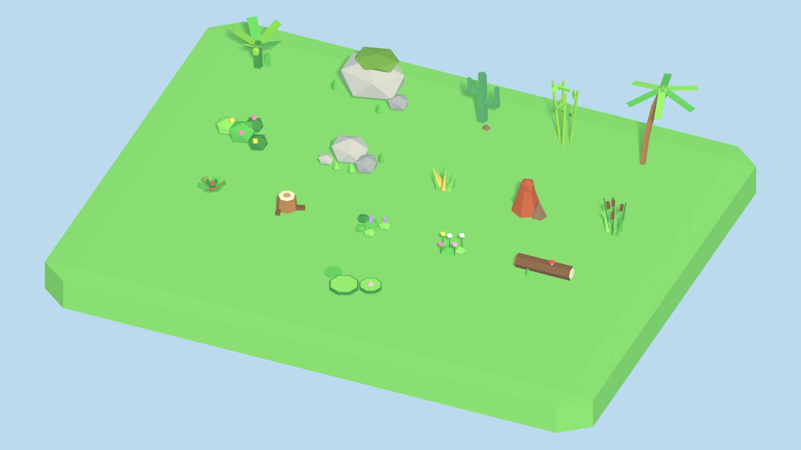

| | Modelo | Descrição | Tris |
|---|---|---|---:|
| 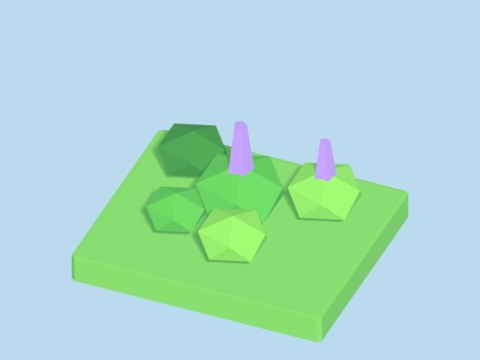 | [`aguape`](models/natureza/aguape.glb) | Aguapés | 132 |
| 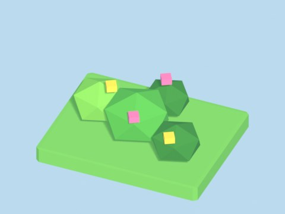 | [`arbustos`](models/natureza/arbustos.glb) | Arbustos de canteiro | 128 |
| 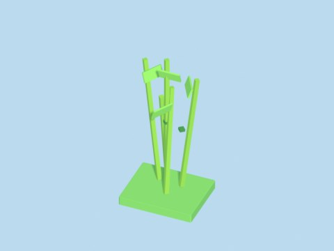 | [`bambu`](models/natureza/bambu.glb) | Moita de bambu | 132 |
| 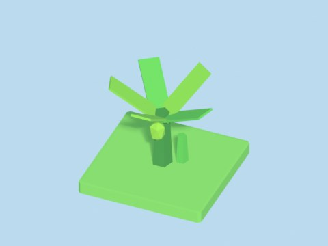 | [`bananeira`](models/natureza/bananeira.glb) | Bananeira | 112 |
| 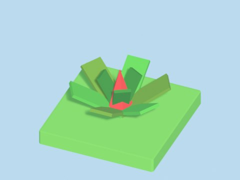 | [`bromelia`](models/natureza/bromelia.glb) | Bromélia | 116 |
| 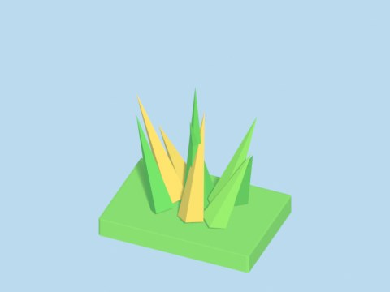 | [`capim_alto`](models/natureza/capim_alto.glb) | Capim alto | 54 |
| 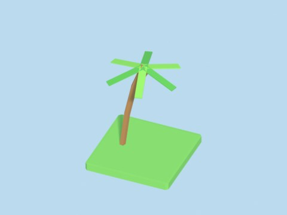 | [`coqueiro`](models/natureza/coqueiro.glb) | Coqueiro | 140 |
| 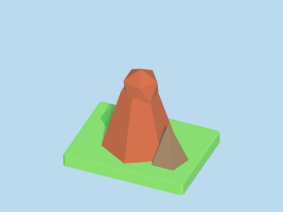 | [`cupinzeiro`](models/natureza/cupinzeiro.glb) | Cupinzeiro | 54 |
| 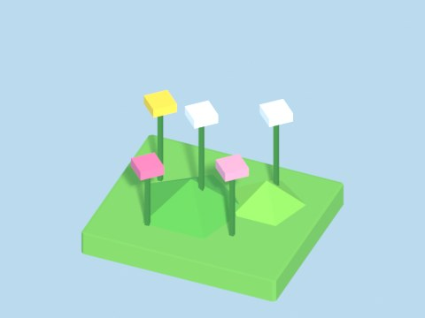 | [`flores_campo`](models/natureza/flores_campo.glb) | Flores do campo | 136 |
| 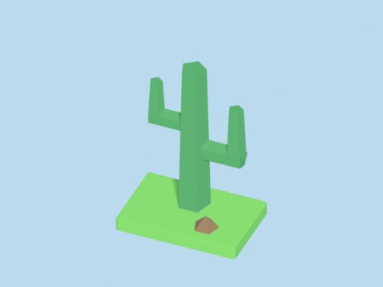 | [`mandacaru`](models/natureza/mandacaru.glb) | Mandacaru | 88 |
| 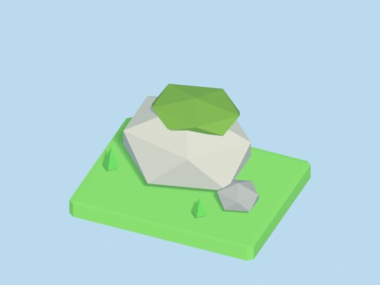 | [`matacao`](models/natureza/matacao.glb) | Matacão | 78 |
| 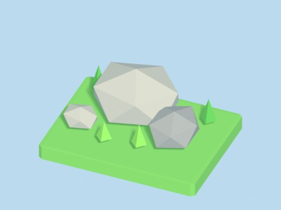 | [`pedras`](models/natureza/pedras.glb) | Pedras de beira de rio | 84 |
| 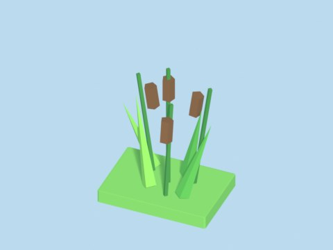 | [`taboa`](models/natureza/taboa.glb) | Taboas de brejo | 136 |
| 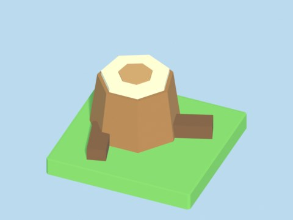 | [`toco`](models/natureza/toco.glb) | Toco de árvore cortada | 96 |
| 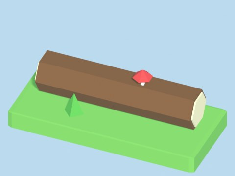 | [`tronco_caido`](models/natureza/tronco_caido.glb) | Tronco caído | 88 |
| 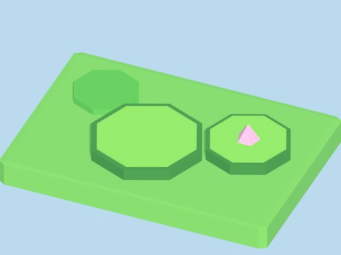 | [`vitoria_regia`](models/natureza/vitoria_regia.glb) | Vitória-régia | 148 |

### Fauna · Wildlife and animals (13)

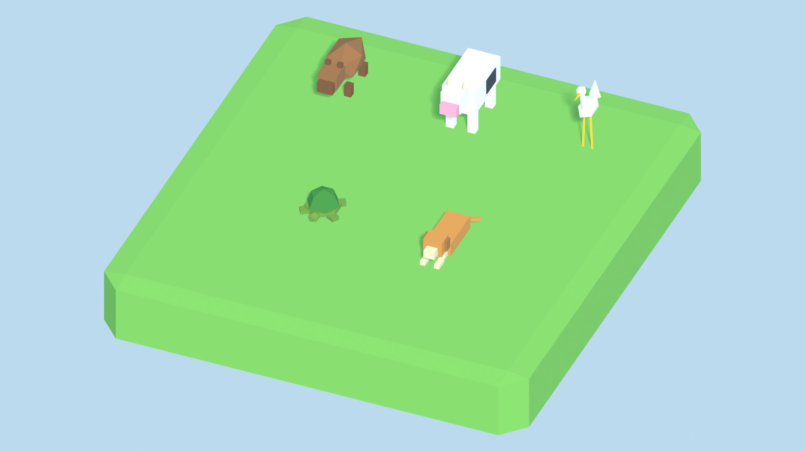

| | Modelo | Descrição | Tris |
|---|---|---|---:|
| 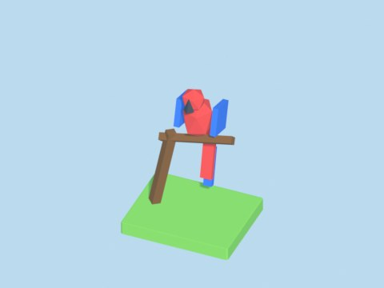 | [`arara`](models/fauna/arara.glb) | Arara-vermelha pousada num galho seco baixo | 118 |
| 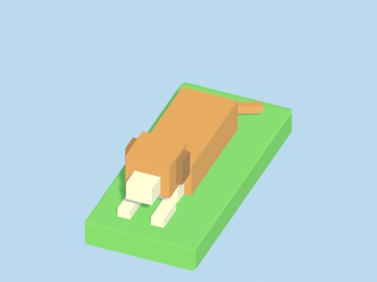 | [`cachorro_caramelo`](models/fauna/cachorro_caramelo.glb) | Cachorro caramelo | 108 |
| 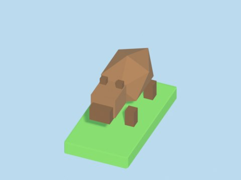 | [`capivara`](models/fauna/capivara.glb) | Capivara | 116 |
| 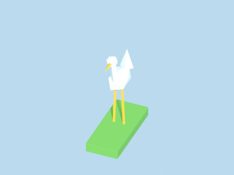 | [`garca`](models/fauna/garca.glb) | Garça branca | 80 |
| 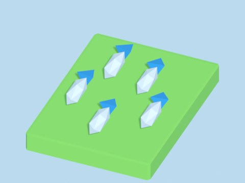 | [`lambaris`](models/fauna/lambaris.glb) | Cardume de lambaris | 120 |
| 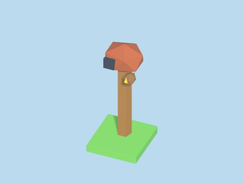 | [`ninho_joao_de_barro`](models/fauna/ninho_joao_de_barro.glb) | Ninho de joão-de-barro | 72 |
| 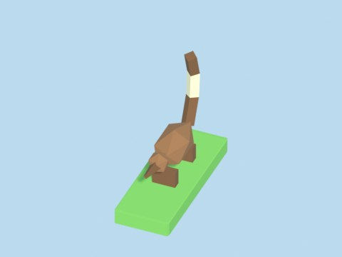 | [`quati`](models/fauna/quati.glb) | Quati | 112 |
| 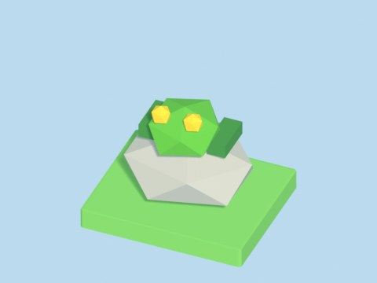 | [`sapo`](models/fauna/sapo.glb) | Sapo verde sentado numa pedrinha da margem, com os olhos saltados em cima e as patas dobradas dos lados | 104 |
| 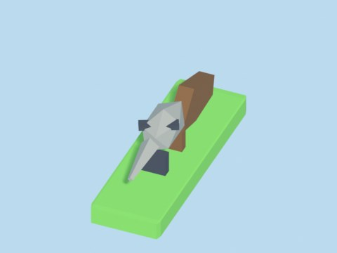 | [`tamandua`](models/fauna/tamandua.glb) | Tamanduá-bandeira | 84 |
| 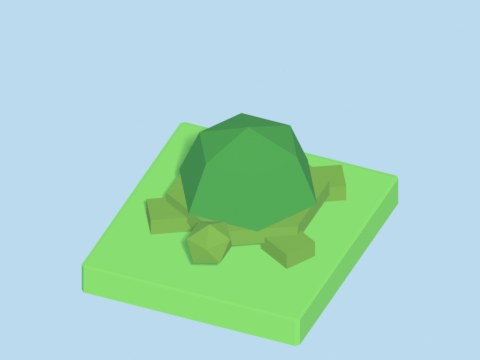 | [`tartaruga`](models/fauna/tartaruga.glb) | Tartaruga de rio | 110 |
| 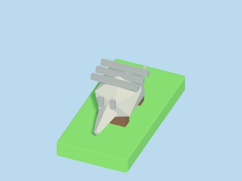 | [`tatu`](models/fauna/tatu.glb) | Tatu | 128 |
| 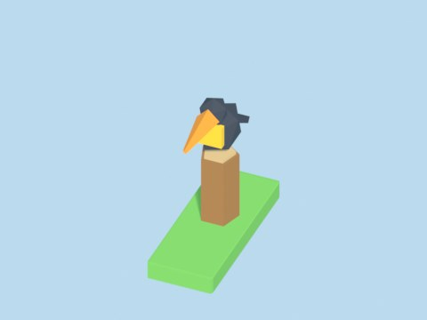 | [`tucano`](models/fauna/tucano.glb) | Tucano | 108 |
| 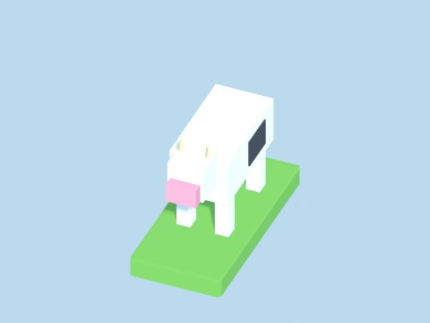 | [`vaca`](models/fauna/vaca.glb) | Vaca malhada de pasto | 128 |

### Rua e bairro · Street and neighborhood (20)

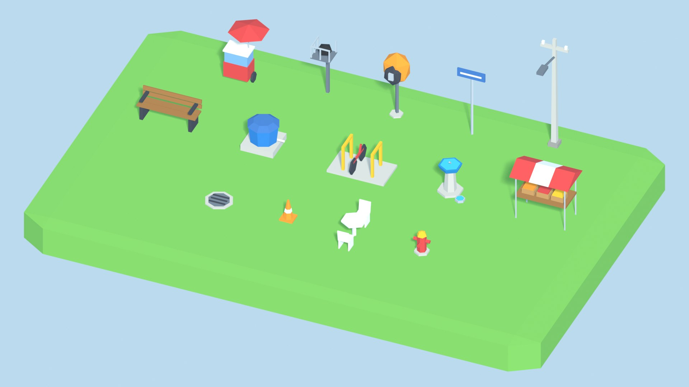

| | Modelo | Descrição | Tris |
|---|---|---|---:|
| 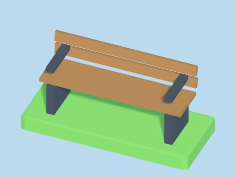 | [`banco_praca`](models/rua/banco_praca.glb) | Banco de praça | 96 |
| 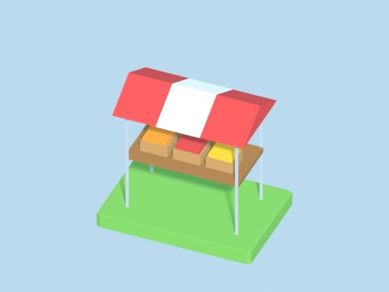 | [`barraca_feira`](models/rua/barraca_feira.glb) | Barraca de feira | 140 |
| 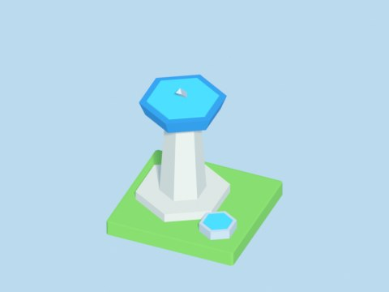 | [`bebedouro`](models/rua/bebedouro.glb) | Bebedouro público | 128 |
| 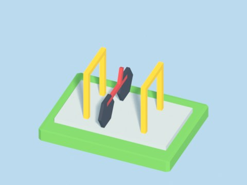 | [`bicicletario`](models/rua/bicicletario.glb) | Bicicletário | 148 |
| 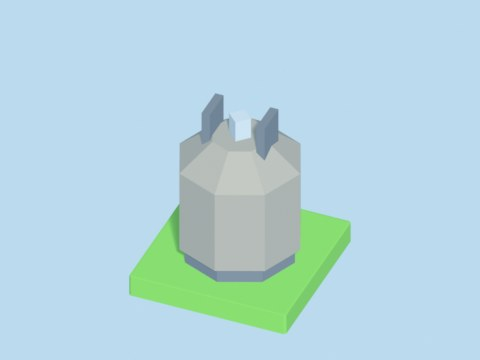 | [`botijao`](models/rua/botijao.glb) | Botijão de gás cinza de cozinha, com base, ombro arredondado, válvula e a alça de proteção no alto | 120 |
| 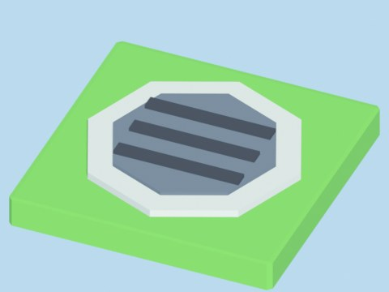 | [`bueiro`](models/rua/bueiro.glb) | Bueiro | 92 |
| 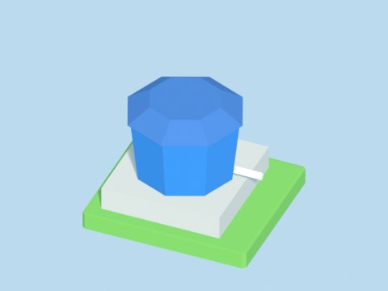 | [`caixa_dagua`](models/rua/caixa_dagua.glb) | Caixa d'água de polietileno | 80 |
| 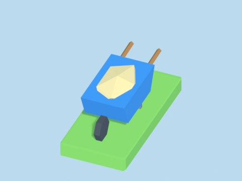 | [`carrinho_mao`](models/rua/carrinho_mao.glb) | Carrinho de mão de obra | 100 |
| 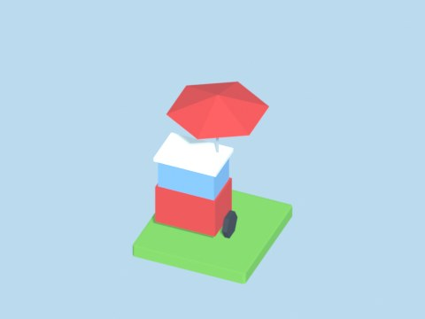 | [`carrinho_pipoca`](models/rua/carrinho_pipoca.glb) | Carrinho de pipoca | 112 |
| 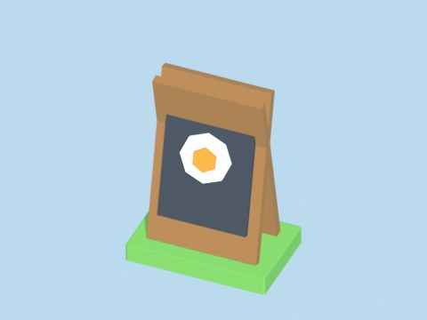 | [`cavalete_pf`](models/rua/cavalete_pf.glb) | Cavalete de calçada em A, de madeira, com um quadro-negro que só mostra o desenho de um prato (sem letras) | 84 |
| 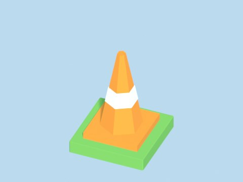 | [`cone_transito`](models/rua/cone_transito.glb) | Cone de trânsito laranja com faixa branca, sobre a base quadrada | 52 |
| 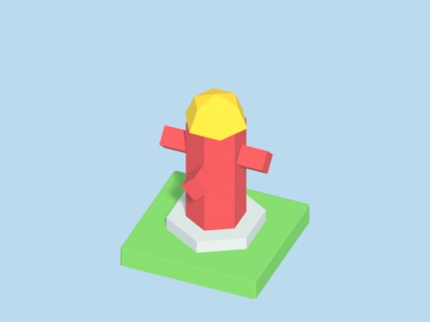 | [`hidrante`](models/rua/hidrante.glb) | Hidrante de rua | 98 |
| 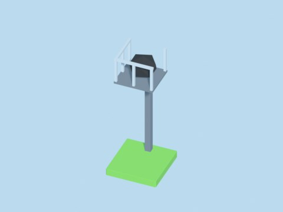 | [`lixeira_grade`](models/rua/lixeira_grade.glb) | Lixeira de grade | 140 |
| 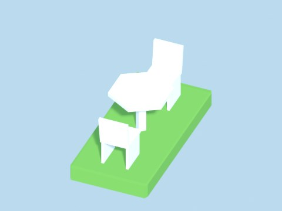 | [`mesa_cadeiras`](models/rua/mesa_cadeiras.glb) | Mesa e duas cadeiras de plástico brancas na calçada, como as de bar de bairro (sem logotipo) | 128 |
| 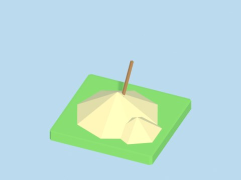 | [`monte_areia`](models/rua/monte_areia.glb) | Monte de areia de obra na calçada, com uma pá fincada no alto | 48 |
| 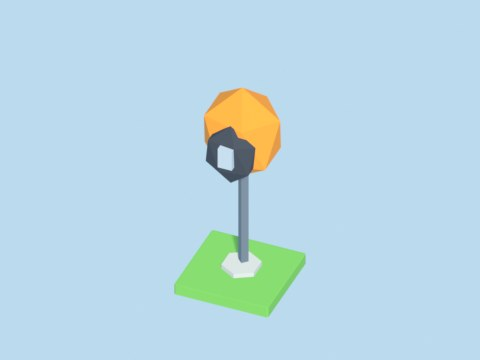 | [`orelhao`](models/rua/orelhao.glb) | Orelhão | 84 |
| 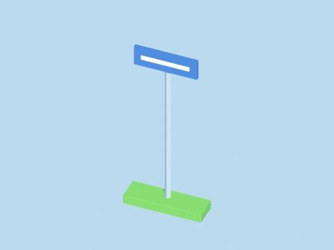 | [`placa_rua`](models/rua/placa_rua.glb) | Placa de rua | 36 |
|  | [`poste_concreto`](models/rua/poste_concreto.glb) | Poste de concreto de rua | 96 |
|  | [`tanque_lavar`](models/rua/tanque_lavar.glb) | Tanque de lavar roupa de cimento | 84 |
|  | [`varal`](models/rua/varal.glb) | Varal de quintal | 84 |

### Rural · Countryside (12)


| | Modelo | Descrição | Tris |
|---|---|---|---:|
|  | [`caixotes`](models/rural/caixotes.glb) | Caixotes de madeira empilhados com laranjas e tomates, como os da colheita no sítio | 108 |
|  | [`cerca_mourao`](models/rural/cerca_mourao.glb) | Cerca de mourões | 60 |
|  | [`cocho_gado`](models/rural/cocho_gado.glb) | Cocho de madeira para o gado com água, sobre dois pés, e um bloco de sal mineral branco ao lado | 96 |
|  | [`colmeia`](models/rural/colmeia.glb) | Colmeia de abelhas | 72 |
|  | [`espantalho`](models/rural/espantalho.glb) | Espantalho | 120 |
|  | [`fardo_feno`](models/rural/fardo_feno.glb) | Fardo de feno redondo | 84 |
|  | [`horta`](models/rural/horta.glb) | Canteiro de horta | 144 |
|  | [`latao_leite`](models/rural/latao_leite.glb) | Latões de leite de alumínio num estrado de madeira na beira da estrada, esperando a coleta | 108 |
|  | [`moinho_vento`](models/rural/moinho_vento.glb) | Cata-vento de bombear água | 136 |
|  | [`pilha_lenha`](models/rural/pilha_lenha.glb) | Pilha de lenha de eucalipto cortada e arrumada entre duas estacas, toras finas deitadas em três camadas | 120 |
|  | [`poco_caipira`](models/rural/poco_caipira.glb) | Poço caipira de tijolo | 124 |
|  | [`porteira`](models/rural/porteira.glb) | Porteira de fazenda | 84 |

### Rio e beira d'água · River and riverside (6)


| | Modelo | Descrição | Tris |
|---|---|---|---:|
|  | [`bombona_flutuante`](models/rio/bombona_flutuante.glb) | Flutuante de bombonas | 116 |
|  | [`canoa`](models/rio/canoa.glb) | Canoa de madeira de pescador boiando | 132 |
|  | [`covo`](models/rio/covo.glb) | Covo de pesca | 100 |
|  | [`pescaria`](models/rio/pescaria.glb) | Pescaria na margem | 98 |
|  | [`rede_pesca`](models/rio/rede_pesca.glb) | Rede de pesca verde secando ao sol, pendurada e caída entre duas estacas na beira do rio, com boias laranja | 120 |
|  | [`trapiche`](models/rio/trapiche.glb) | Trapiche | 120 |

### Tecnologia sustentável · Sustainable technology (7)


| | Modelo | Descrição | Tris |
|---|---|---|---:|
|  | [`barril_chuva`](models/tecnologia/barril_chuva.glb) | Barril de captação de chuva | 124 |
|  | [`boia_rio`](models/tecnologia/boia_rio.glb) | Boia de monitoramento do rio | 128 |
|  | [`hidrometro`](models/tecnologia/hidrometro.glb) | Hidrômetro | 80 |
|  | [`lixeiras_coleta`](models/tecnologia/lixeiras_coleta.glb) | Lixeiras de coleta seletiva simples | 120 |
|  | [`placa_educativa`](models/tecnologia/placa_educativa.glb) | Placa educativa de beira de rio | 132 |
|  | [`pluviometro`](models/tecnologia/pluviometro.glb) | Pluviômetro | 88 |
|  | [`poste_solar`](models/tecnologia/poste_solar.glb) | Poste solar | 112 |

### Sinais de poluição · Pollution signs (19)


| | Modelo | Descrição | Tris |
|---|---|---|---:|
|  | [`barranco_erodido`](models/poluicao/barranco_erodido.glb) | Barranco erodido sem mata ciliar | 140 |
|  | [`cacamba_entulho`](models/poluicao/cacamba_entulho.glb) | Caçamba de entulho amarela, pequena, transbordando de tijolos, restos de concreto e tábuas quebradas | 88 |
|  | [`cano_pvc`](models/poluicao/cano_pvc.glb) | Cano de PVC improvisado saindo do barranco e despejando um fio de esgoto escuro para a frente, na água | 92 |
|  | [`carcaca_carro`](models/poluicao/carcaca_carro.glb) | Carcaça de carro abandonado | 96 |
|  | [`carrinho_mercado`](models/poluicao/carrinho_mercado.glb) | Carrinho de supermercado jogado no córrego | 68 |
|  | [`entulho`](models/poluicao/entulho.glb) | Entulho | 102 |
|  | [`espuma_rio`](models/poluicao/espuma_rio.glb) | Espuma de poluição | 100 |
|  | [`galao_agrotoxico`](models/poluicao/galao_agrotoxico.glb) | Galões de agrotóxico vazios jogados no chão (sem rótulo), um tombado, com uma mancha escura de vazamento | 104 |
|  | [`geladeira_velha`](models/poluicao/geladeira_velha.glb) | Geladeira velha tombada no terreno baldio | 60 |
|  | [`lixo_flutuante`](models/poluicao/lixo_flutuante.glb) | Lixo boiando no rio | 128 |
|  | [`manilha_esgoto`](models/poluicao/manilha_esgoto.glb) | Manilha de esgoto | 128 |
|  | [`monte_lixo`](models/poluicao/monte_lixo.glb) | Monte de lixo | 136 |
|  | [`peixe_morto`](models/poluicao/peixe_morto.glb) | Peixes mortos boiando | 92 |
|  | [`pilha_toras`](models/poluicao/pilha_toras.glb) | Pilha de toras grossas de mata derrubada, empilhadas na clareira esperando o caminhão, com as pontas cortadas claras | 144 |
|  | [`pneus_velhos`](models/poluicao/pneus_velhos.glb) | Pneus velhos | 136 |
|  | [`saco_lixo`](models/poluicao/saco_lixo.glb) | Sacos de lixo | 78 |
|  | [`sofa_velho`](models/poluicao/sofa_velho.glb) | Sofá velho abandonado na calçada | 72 |
|  | [`tambor_enferrujado`](models/poluicao/tambor_enferrujado.glb) | Tambor enferrujado | 132 |
|  | [`toco_serrado`](models/poluicao/toco_serrado.glb) | Toco recém-serrado | 102 |

### Detalhados (até 1.500 tris) · Detailed (up to 1,500 tris) (4)


| | Modelo | Descrição | Tris |
|---|---|---|---:|
|  | [`cisterna`](models/detalhados/cisterna.glb) | Cisterna de placas (semiárido) | 600 |
|  | [`composteira`](models/detalhados/composteira.glb) | Composteira de dois módulos de ripas de madeira | 1332 |
|  | [`lixeira_seletiva`](models/detalhados/lixeira_seletiva.glb) | Lixeira seletiva de rua | 936 |
|  | [`ponto_onibus`](models/detalhados/ponto_onibus.glb) | Ponto de ônibus com telhado verde | 480 |

### Árvores nativas (até 1.500 tris) · Native trees (up to 1,500 tris) (3)


| | Modelo | Descrição | Tris |
|---|---|---|---:|
|  | [`araucaria`](models/arvores/araucaria.glb) | Araucária (pinheiro-do-paraná) | 548 |
|  | [`buriti`](models/arvores/buriti.glb) | Buriti (palmeira das veredas) | 636 |
|  | [`ipe_amarelo`](models/arvores/ipe_amarelo.glb) | Ipê-amarelo (árvore nativa) | 388 |

<!-- catalogo:fim -->

## Gerar ou modificar os modelos

Cada modelo é um script Python curto em `src/<categoria>/<id>.py` que usa as peças de [`src/lib.py`](src/lib.py)
(caixas, cilindros, cones, canos, icoesferas baixas…) e uma única paleta de cores. Precisa do Blender 4.5 LTS.

```bash
blender -b --factory-startup --python src/rua/orelhao.py              # um modelo → models/rua/orelhao.glb
blender -b --factory-startup --python src/gerar_todos.py              # todos (+ models/catalogo.json)
blender -b --factory-startup --python src/gerar_todos.py -- poluicao  # uma categoria
blender -b --factory-startup --python src/vitrine.py -- tudo --cada   # imagens em previews/
blender -b --factory-startup --python src/vitrine.py -- todos         # previews/todos.jpg (renomeie para capa.jpg)
py -3 tools/atualizar_readme.py                                       # refaz o catálogo dos dois READMEs
```

Para um prop novo: copie um script parecido, monte com a **frente para -Y do Blender** (`exportar` gira 180°, e a
frente fica em -Z no glTF), use só cores da `PALETA`, sem chanfro (custa triângulos), e ponha o nome em inglês em
[`tools/nomes_en.json`](tools/nomes_en.json).

## Perguntas frequentes

**Posso usar num jogo comercial?**
Sim. Tudo é domínio público (CC0 1.0): uso comercial, modificação e redistribuição liberados, sem pedir
permissão nem pagar.

**Preciso dar crédito?**
Não, é opcional. Para citar, os dados estão em [CITATION.cff](CITATION.cff).

**São leves mesmo?**
Quase todos têm até 150 triângulos e nenhuma textura: centenas de props custam muito pouco. Junte por área ou use
instâncias na GPU (uma chamada de desenho por tipo).

**Por que props de poluição?**
Para o impacto ambiental ficar visível: num jogo educativo, lixo, espuma e esgoto podem aparecer quando a poluição
sobe e sumir quando o jogador resolve a causa. Os peixes mortos são de desenho, sem sangue.

## Origem e créditos

O kit nasceu do jogo educativo [Guardião da Água](https://github.com/kayquer/guardiao_da_agua_js), produto da
pesquisa de mestrado de Cláudia Dias Roxinol (Unesp, Presidente Prudente), desenvolvido com Kayque Rotondo. Ele
complementa o [Kit Cidade Low Poly](https://github.com/kayquer/kit-cidade-lowpoly) (prédios, ruas e veículos). Os
modelos e scripts foram feitos com o Blender e com o Claude (Anthropic) como assistente. Nenhum modelo de terceiros
faz parte deste repositório.
